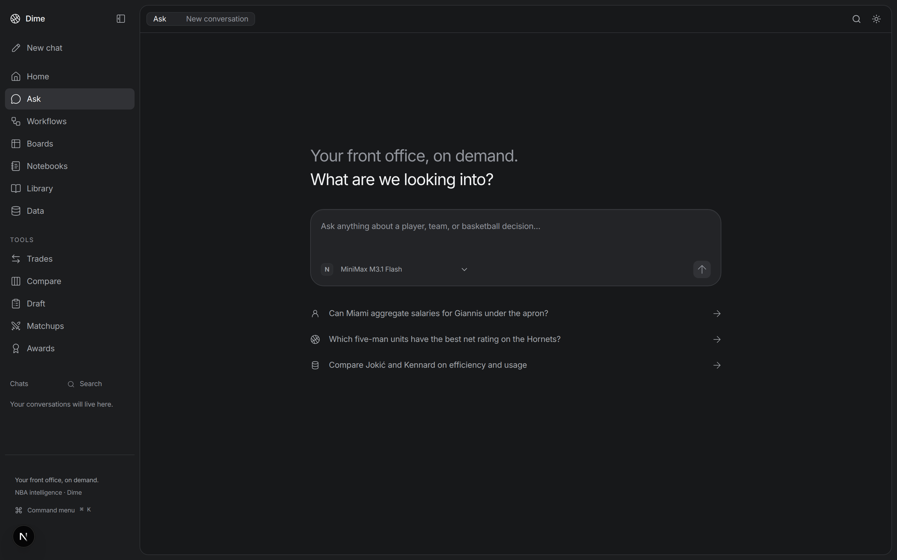
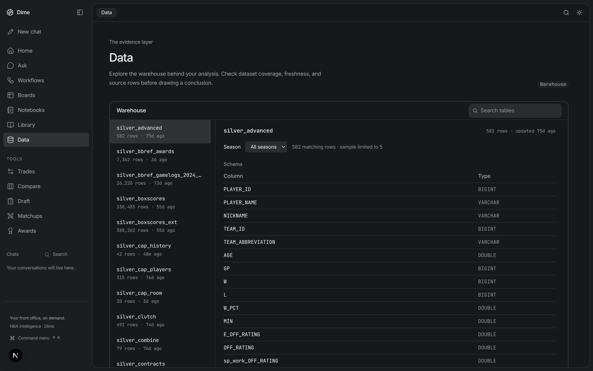
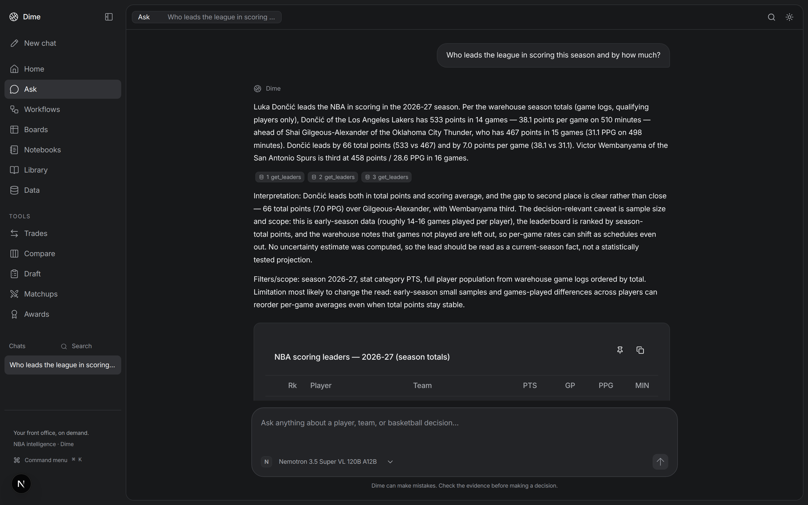
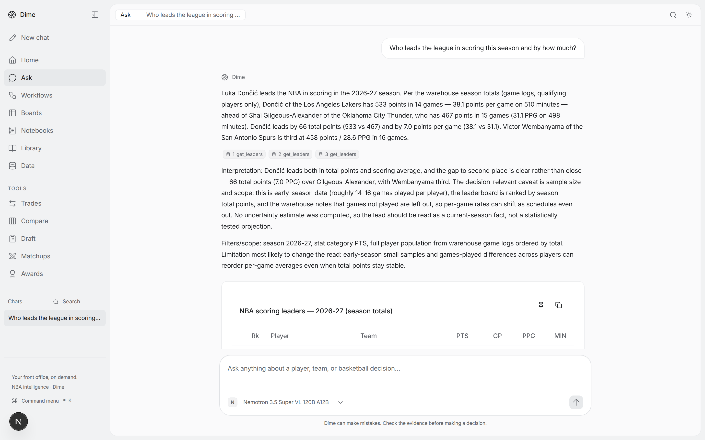

# Dime

Ask NBA questions in plain English. Dime plans the query, runs it
against its own data warehouse, and shows its work.

Website: [mythiipanda.github.io/dime-site](https://mythiipanda.github.io/dime-site/)

Live demo: [dime-fawn.vercel.app](https://dime-fawn.vercel.app)

<video src="assets/readme/dime-motion-demo.mp4" controls muted loop playsinline width="100%"></video>

Ask → streamed answer with sources:

<video src="assets/readme/dime-ask-demo.mp4" controls muted loop playsinline width="100%"></video>

Trade check → salary resolution, apron rules, pin to board:

<video src="assets/readme/dime-trade-demo.mp4" controls muted loop playsinline width="100%"></video>







## Analyst runtime

See the [current architecture](ARCHITECTURE.md) and [domain glossary](GLOSSARY.md).

The chat route now uses the Pi analyst session. Python exposes read-only SQL and warehouse schema; codemode can also read prior source records. Answers retain source rows, declared units and provenance with unassessed verification. One bounded live-provider run completed before the latest structured-result change; that change has fixture proof only, and broad provider, container, concurrency and answer-quality checks remain open. See [the analyst module](backend/analyst/README.md) for packaging and fixture commands.

## Features

Frontend contributors: read the [Dime design system](frontend/DESIGN_SYSTEM.md).
The live component reference is available at `/design-system`.

- Chat that answers with numbers, not vibes. Every stat comes
  out of the warehouse and the reply shows the tables, charts,
  and shot maps behind it.
- Current season (2025-26): scoring, efficiency, true shooting,
  four factors, on/off splits, clutch numbers, shot zones,
  lineups, rest advantage, game predictions, head-to-heads.
  Trade checks against the 2026-27 cap ledger, award races,
  and draft history back to 1947.
- History: player and team seasons back to 1946-47, game
  logs, shots, possessions, lineups, and standings for
  2009-10 through 2025-26, play-by-play for 2020-21
  through 2024-25, and RAPTOR back to 1976-77. Injuries,
  salaries back to 1984-85, cap and apron history,
  draft-combine measurements, Synergy play types, hustle
  stats, coach staffs, officials, G League seasons, and
  player bios.
- Fixed answers come from code, not recall. Records, four
  factors, Finals results, and rankings are computed from
  warehouse rows. Outside the coverage window, the answer
  says so instead of guessing.
- Read-only SQL and warehouse schema over a local DuckDB
  warehouse. Chat runs on configured providers behind one
  interface.
- Streams tokens and live tool activity over SSE, in dark
  and light themes.



## Quickstart

Backend (Node 22.19+ and Python 3.12):

```bash
# warehouse: fetch the Hugging Face dataset (verifies checksum, writes backend/data/warehouse.duckdb)
./scripts/fetch-data.sh
cd backend
uv venv --python 3.12
uv pip install -r requirements.txt
cp .env.example .env   # add your LLM keys for chat; the server boots without them
cd analyst
npm ci --ignore-scripts
npm run build
cd ..
node --env-file=.env analyst/dist/host.js manifest manifest/expected_asset_manifest.json
DIME_EXPECTED_ASSET_MANIFEST=$PWD/manifest/expected_asset_manifest.json \
  PORT=8010 node --env-file=.env analyst/dist/host.js
```

The manifest step is required. Without
`DIME_EXPECTED_ASSET_MANIFEST`, the server exits at startup
with a startup configuration failure.

Frontend:

```bash
cd frontend
npm install
NEXT_PUBLIC_BACKEND_URL=http://127.0.0.1:8010 npm run dev
```

Open http://localhost:3000 and ask: "What are the Thunder's
four factors this season?"

## How it works

```
frontend/   Next.js 16, React 19, Tailwind 4, Recharts.
            Streams tokens and live tool activity over SSE; dark and light themes.
backend/    TypeScript host with a Python data engine over a local
            DuckDB warehouse.
infra/      Azure Container Apps, scale-to-zero.
```

You type a question. The analyst picks the tools, runs them
against the warehouse, and streams back the answer with the
source data attached.

The v2 chat route is the Pi analyst path. `DIME_RUNTIME_V2`
accepts `on`, `action_loop`, `shadow` and `off`; unset means
`on`. Only `on` and `action_loop` enable the chat, project,
branch and run-source endpoints. Workspaces mount separately
and are not behind this flag.

## Data

The warehouse is a DuckDB file hosted as the private Hugging Face
dataset `mythiix/dime-warehouse`. On backend changes, CI downloads
`warehouse.duckdb` from that dataset, verifies its checksum, and
builds derived tables at image time before pushing
`ghcr.io/mythiipanda/dime-backend:latest`. For local dev,
`./scripts/fetch-data.sh` fetches the current dataset file
(checksum-verified) and exits 1 on failure. Publish an updated
warehouse with `backend/scripts/publish_warehouse.py` after ingest.
The warehouse is the primary source at answer time; on misses, some datasets fall back to live sources (nba_stats, ESPN) where configured, and that fallback can fail or time out.

The current dataset holds 74 tables. A fresh backfill covers
2015-16 through 2024-25 with 330,485 boxscore rows and 40,000
lineup rows. The dataset also carries the historical tables:
RAPTOR, RAPM, shots, advanced stats, on/off splits, clutch
splits, leaders, salaries, zone splits, transactions, and
the `hist_*` tables — player seasons, team seasons and drafts
back to 1946-47, game logs to 1996-97, and shots to 2009-10,
all through 2025-26 where the source reaches. Derived tables
(four factors, draft capital, injury entries, team season
summaries) are rebuilt by `backend/scripts/refresh_warehouse.py`
and published with `backend/scripts/publish_warehouse.py`.

## Evals and tests

The benchmark pack lives in the private dime-internal repo
at `evals/benchmark-pack/`. It runs 35 scenarios against a
live backend with expected-answer assertions. From a
dime-internal checkout:

```bash
python evals/benchmark-pack/runner.py --url http://127.0.0.1:8010 --out reports/run.json
```

The pytest suite (`backend/tests/`, 218 test files) covers
routing, the pinned lanes, warehouse contracts, and
streaming:

```bash
cd backend
pytest tests/ -q
```

## Contributing

Push backend changes on `dev` and CI builds the backend
image with the warehouse baked in. Run `pytest tests/ -q`
from `backend/` before you open a PR. Deployments go
through `infra/deploy.sh`, which needs `az login` and the
LLM keys in `backend/.env` (pushed as Container App
secrets, never committed).

## License

No license file ships with the repo yet.
